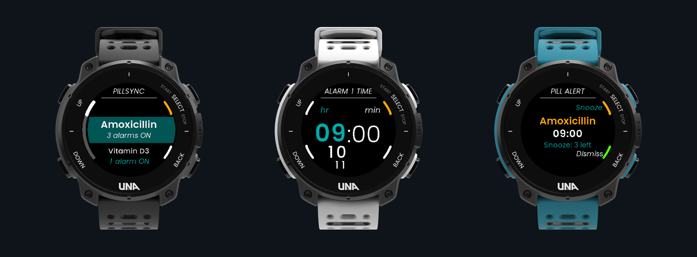
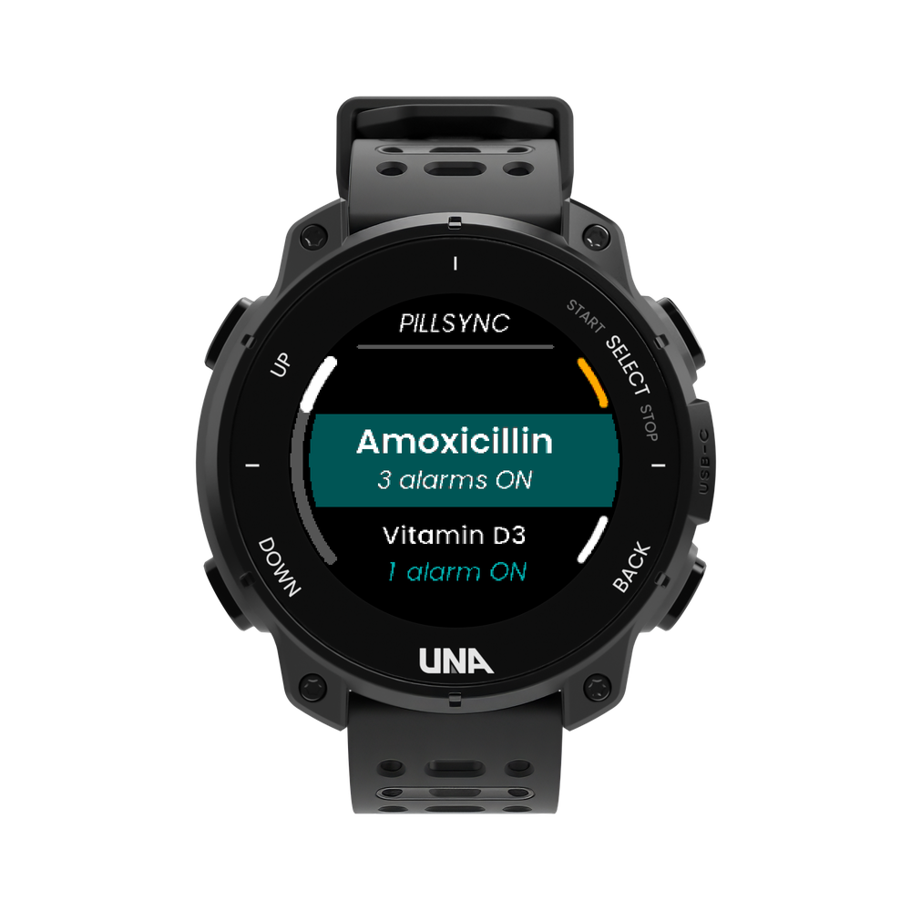
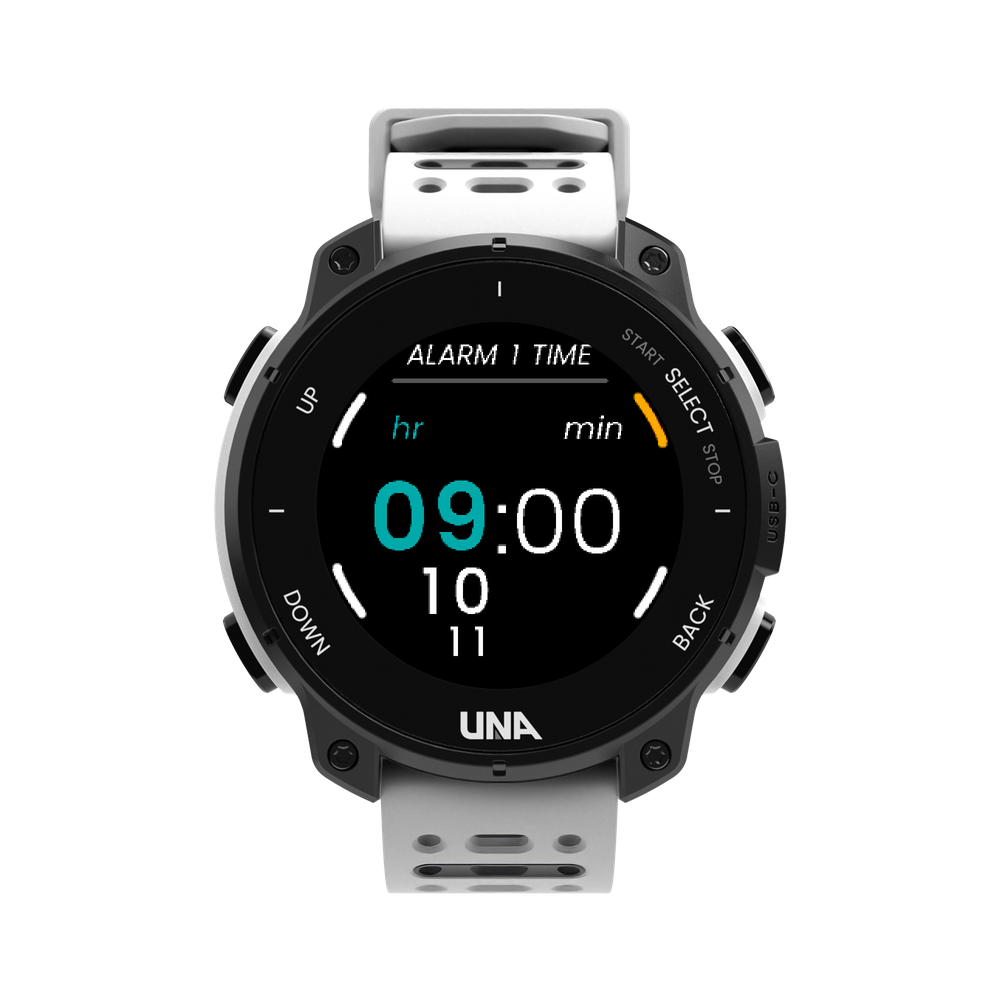
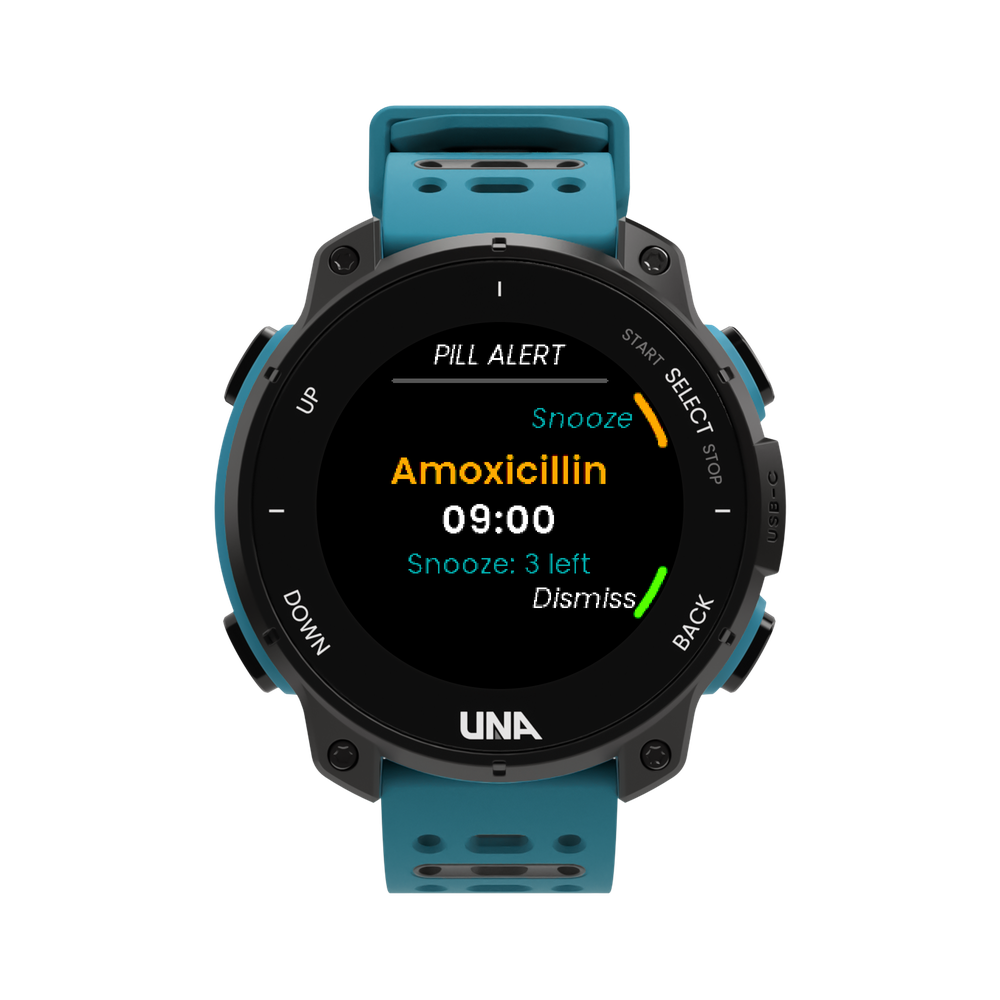

# PillSync — UNA Watch Medication Reminder App



**PillSync** is a medication tracking and daily reminder application for the UNA Watch built on the UNA Watch SDK (`UNAWatch/una-sdk`) with an LVGL GUI and an autostart background service.

## App Screenshots

| Black UNA Watch | White UNA Watch | Teal UNA Watch |
| :---: | :---: | :---: |
|  |  |  |
| **Main Screen**<br>Medication wheel menu showing active alarm counts | **Alarm Time Picker**<br>Two-tone 60pt HH:MM picker with upcoming hours | **Active Pill Alert**<br>Ringing reminder with 3× Snooze & Dismiss |

<p align="center">
  
  <br>
  <em>App Store Icon</em>
</p>

## Features

- **Track 5 Medications**: Configure up to 5 medications (`Medication 1` – `Medication 5`), each with its own name (up to 16 characters) and master `Enabled` toggle.
- **3 Daily Alarms per Medication**: Each medication has 3 independent daily alarm slots (e.g., `09:00`, `10:00`, `18:00`) that can be toggled `ON`/`OFF` and set to any 24-hour time (`HH:MM`).
- **Snooze up to 3 Times, then Dismiss**:
  - When a medication alarm triggers, the background service wakes the display, plays buzzer and vibration alerts, and opens the **Ringing** screen showing the medication name, scheduled time, and remaining snoozes (`Snooze: 3 left` -> `2 left` -> `1 left`).
  - Press **R1 (Top-Right)** to snooze for 5 minutes (up to 3 times).
  - Once an alarm has been snoozed 3 times (`Max snoozes (3/3)`), the Snooze action is hidden and only **R2 (Bottom-Right, Dismiss)** is available.
  - Press **R2 (Bottom-Right)** at any time to dismiss the alarm and cancel any remaining snoozes for that slot.
- **Alert Mode (Sound & Vibrate / Vibrate Only)**: Choose between **Sound & Vibrate** (default) or **Vibrate Only** (silent buzzer) from either the watch UI or the UNA Watch Companion App (`vibrateOnly`).
- **Dual Configuration (Companion App + On-Watch UI)**:
  - **UNA Watch Companion App (`SDK::AppConfig`)**: `Output/app-manifest.json` and `Software/Libs/Header/AppConfigFields.hpp` declare all 26 configuration fields (`med1Name`, `med1Enabled`, `med1Alarm1`..`med5Alarm3`, and `vibrateOnly`) stored in `app_config.json`.
  - **On-Watch LVGL UI**: Browse all 5 medications, toggle medications or individual alarms `ON`/`OFF`, switch alert mode (`Sound & Vibrate` / `Vibrate Only`), and edit alarm times (`HH:MM`) using the two-stage `TwoTonePicker` directly on the watch. Edits made on the watch are written back to `app_config.json` and `pillsync.json`.

## Project Layout

```text
PillSync/
├── Output/
│   ├── app-manifest.json          # Companion app manifest & 26 configFields schema
│   └── PillSync_1.3.0.uapp        # Built watch application package
├── Resources/
│   ├── icon_30x30.png             # 30x30 small app icon
│   ├── icon_60x60.png             # 60x60 main app icon
│   ├── icon_appstore_512x512.png  # 512x512 App Store icon
│   ├── icon_appstore_1024x1024.png# 1024x1024 high-res icon
│   ├── screen_black_watch.png     # Main screen mockup on Black watch
│   ├── screen_white_watch.png     # Time picker mockup on White watch
│   ├── screen_teal_watch.png      # Pill alert mockup on Teal watch
│   └── pillsync_watches_showcase.png # 3-watch showcase banner
├── Software/
│   ├── Libs/
│   │   ├── libs.cmake
│   │   ├── Header/
│   │   │   ├── AppConfigFields.hpp
│   │   │   ├── Commands.hpp
│   │   │   ├── Medication.hpp
│   │   │   ├── PillManager.hpp
│   │   │   └── Service.hpp
│   │   └── Sources/
│   │       ├── AppConfigFields.cpp
│   │       ├── PillManager.cpp
│   │       └── Service.cpp
│   └── Apps/
│       ├── PillSync-CMake/
│       │   └── CMakeLists.txt     # Watch target build (.uapp)
│       └── LVGL-GUI/
│           ├── lvgl-gui.cmake
│           ├── assets/            # Pre-converted Poppins LVGL font C files
│           ├── gui/               # Model, Theme, TwoTonePicker, and 6 LVGL screens
│           └── simulator/         # PC SDL2 + LVGL simulator target
└── Tests/
    ├── CMakeLists.txt
    └── PillManager_test.cpp       # Host unit tests for schedule, AppConfig, and 3x snooze
```

## Building & Verifying

Ensure `UNA_SDK` points to your UNA Watch SDK checkout:

1. **Validate `app-manifest.json` & `AppConfigFields`**:
   ```sh
   $UNA_PYTHON_EXECUTABLE $UNA_SDK/Utilities/Scripts/app_packer/validate_app_config.py \
     --check Output/app-manifest.json \
     --check-bounds Software/Libs/Sources/AppConfigFields.cpp
   ```

2. **Build Watch `.uapp` Package**:
   ```sh
   cmake -S Software/Apps/PillSync-CMake -B Software/Apps/PillSync-CMake/build
   cmake --build Software/Apps/PillSync-CMake/build -j8
   ```

3. **Run Host Unit Tests**:
   ```sh
   cmake -S Tests -B Tests/build
   cmake --build Tests/build -j8
   ctest --test-dir Tests/build -V
   ```

